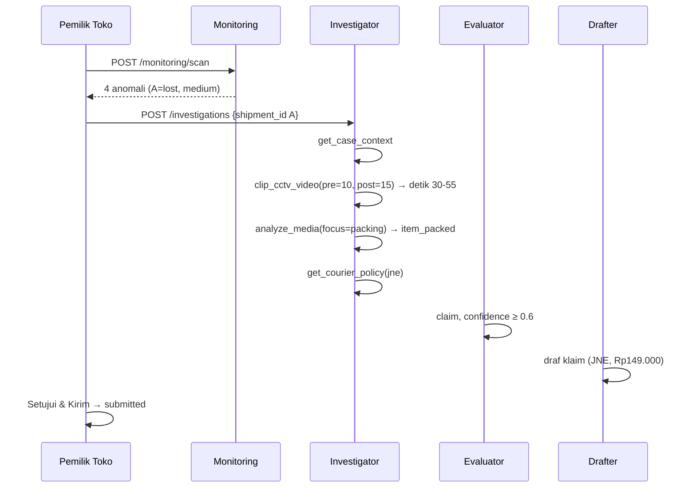

# Data Dummy & Rencana Video ClaimGuard

Versi 1.0 · 21 Oktober 2026 · Acuan: [SRS.md](SRS.md) v2.3 §8, §13, §14, §15.5
Pembaca: Backend B (seed), Frontend B (rekaman video), Backend A (prompt & cache).

> **Status dokumen.** Isi tabel di bagian 3–4 adalah **rencana yang belum diterapkan** ke
> `backend/data/mock/shipments.json`. Bagian 9 memuat diff yang harus dijalankan. Nomor resi
> skenario **tidak boleh diubah** setelah cache AI direkam (lihat §8).

> **Pembaruan 22 Okt:** keputusan C2 diganti dari `needs_evidence` menjadi keputusan baru
> `seller_error` (Evaluator), agar fitur "Minta bukti ke pembeli" (F6) tidak muncul untuk
> kasus yang kesalahannya di pihak penjual. C2 sudah diterapkan di `shipments.json`.

---

## 1. Prinsip

1. **Deterministik.** Seed menghasilkan data yang sama setiap kali `POST /demo/reset`.
2. **Jujur.** Semua data ditandai `is_simulated = true` (FR-21). Tidak ada hasil AI palsu
   di-seed; `investigations`, `evidence`, `claims`, dan `audit_logs` selalu **kosong** setelah
   reset dan hanya terisi oleh proses nyata.
3. **Mudah diproduksi.** Barang dipilih yang mudah dibeli/ditemukan: kaos polos, inhaler,
   kardus bekas pakai ulang. Tidak ada properti khusus di video.
4. **Konsisten.** Jam overlay CCTV = `recorded_start + detik video`, sama dengan `scanned_at`
   di JSON. Satu ketidaksinkronan = satu skenario gagal.

---

## 2. Ringkasan kebutuhan

| Kategori | Jumlah | Total durasi |
| --- | --- | --- |
| Resi (`shipments`) | 17 | — |
| Event tracking | 32 | — |
| Media (video) | 5 | ±7 menit |
| Kebijakan kurir | 3 | — |
| Anomali yang muncul saat scan | 4 (+1 opsional, C2) | — |
| File yang direkam tim | 5 | 420 detik |

### Peta skenario → media → keputusan

| Resi | Skenario | Media yang dipakai | Keputusan akhir | Klaim ke kurir | Resi anomali |
| --- | --- | --- | --- | --- | --- |
| `JNE0012345678` | A — paket hilang | CCTV-01 detik 40 | `claim` | ✅ JNE | SLA |
| `JT7788990011` | B — barang rusak | CCTV-01 detik 95 + unboxing inhaler | `claim` | ✅ J&T | Laporan rusak |
| `SCP5566778899` | C1 — retur curang | CCTV-01 detik 150 + unboxing kaos | `fraud_suspect` | ❌ | Sengketa retur |
| `SCP8899770011` | C2 — penjual salah kirim | CCTV-02 detik 30 + unboxing kaos hitam | `seller_error` | ❌ | Sengketa retur |
| `JNE0099887766` | D — tertahan tanpa CCTV | tidak ada | `needs_evidence` | ❌ | SLA |

**Lima keputusan demo** membuktikan tiga hal: sistem bisa **menagih** (A, B), **menolak**
(C1), dan **tidak menuduh** ketika bukti menunjuk ke penjual (C2) atau tidak tersedia (D).

---

## 3. Data dummy per tabel

### 3.1 `shipments` — 17 baris

Semua waktu UTC (WIB = UTC + 7). `is_simulated = true`.
Kolom `A/B/C1/C2/D` hanya penanda dokumen, tidak ada di database.

| # | tracking_number | kurir | status | rute | shipped_at | sla_deadline | item_name | item_value | buyer_report |
| --- | --- | --- | --- | --- | --- | --- | --- | --- | --- |
| **A** | `JNE0012345678` | jne | `in_transit` | Bandung → Surabaya | 17 Okt 03:00 | 19 Okt 03:00 | Kaos polos putih (2 pcs) | 149000 | `null` |
| **B** | `JT7788990011` | jnt | `delivered` | Bandung → Jakarta Selatan | 17 Okt 04:00 | 19 Okt 04:00 | Inhaler (alat bantu pernapasan) | 385000 | Inhaler retak dan tidak bisa dipakai. Kardus penyok di bagian sudut, bubble wrap-nya sobek. Saya rekam dari kotak masih tertutup. |
| **C1** | `SCP5566778899` | sicepat | `returned` | Bandung → Yogyakarta | 17 Okt 04:30 | 19 Okt 04:30 | Kaos polos putih, ukuran M | 89000 | Warna kaos berbeda dari pesanan; saya pesan putih tapi yang datang merah, minta retur dana. |
| **C2** | `SCP8899770011` | sicepat | `returned` | Bandung → Surabaya | 18 Okt 03:30 | **25 Okt 03:30** | Kaos polos hitam, ukuran L | 95000 | Saya pesan kaos hitam ukuran L, tapi yang datang kaos merah ukuran M. Warnanya berbeda dari pesanan. Saya minta retur. |
| **D** | `JNE0099887766` | jne | `in_transit` | Bandung → Medan | 16 Okt 05:00 | 20 Okt 05:00 | Kaos polos 3 pcs | 150000 | `null` |
| 6 | `JT1122334455` | jnt | `out_for_delivery` | Bandung → Depok | 21 Okt 02:00 | 27 Okt 02:00 | Tas selempang | 320000 | `null` |
| 7 | `SCP1029384756` | sicepat | `delivered` | Bandung → Bekasi | 18 Okt 03:00 | 20 Okt 03:00 | Botol minum | 89000 | Barang sudah diterima, terima kasih. |
| 8 | `JNE0055443322` | jne | `picked_up` | Bandung → Malang | 21 Okt 08:00 | 28 Okt 08:00 | Jaket denim | 380000 | `null` |
| 9 | `JT6677889900` | jnt | `delivered` | Bandung → Bogor | 18 Okt 05:00 | 20 Okt 05:00 | Lampu meja | 210000 | `null` |
| 10 | `SCP9988776655` | sicepat | `in_transit` | Bandung → Makassar | 21 Okt 03:00 | 29 Okt 03:00 | Jam tangan | 540000 | `null` |
| 11 | `JNE0011223344` | jne | `created` | Bandung → Tangerang | 22 Okt 01:00 | 27 Okt 01:00 | Buku resep | 95000 | `null` |
| 12 | `JT5544332211` | jnt | `in_transit` | Bandung → Semarang | 21 Okt 06:00 | 26 Okt 06:00 | Sprei katun | 260000 | `null` |
| 13 | `SCP2233445566` | sicepat | `delivered` | Bandung → Cirebon | 19 Okt 02:00 | 21 Okt 02:00 | Mug custom | 75000 | `null` |
| 14 | `JNE0066778899` | jne | `out_for_delivery` | Bandung → Bandar Lampung | 20 Okt 03:00 | 26 Okt 03:00 | Sepatu lari | 499000 | `null` |
| 15 | `JT9900112233` | jnt | `picked_up` | Bandung → Denpasar | 22 Okt 02:00 | 30 Okt 02:00 | Kain batik | 185000 | `null` |
| 16 | `SCP7788001122` | sicepat | `delivered` | Bandung → Solo | 18 Okt 07:00 | 20 Okt 07:00 | Tumbler stainless | 135000 | `null` |
| **17** | `JNE0033445566` | jne | `delivered` | Bandung → Sukabumi | 19 Okt 02:00 | 21 Okt 02:00 | Kaos polos 2 pcs | 130000 | Barang sudah diterima, sesuai pesanan, terima kasih. |

**Catatan per baris.**

- **A** — dipakai skenario utama. `now` demo ±21 Okt 13:00 → terlambat ±2,4 hari →
  severity `medium`. Untuk mendapatkan `high`, geser `sla_deadline` ke `18 Okt 03:00`.
- **B** — `buyer_report` memuat `retak` (regex `_DAMAGE`) → flag `BUYER_REPORTED_DAMAGE`.
  Nilai 385.000 < batas J&T Rp1.000.000 sehingga kompensasi draf tidak melanggar kebijakan.
- **C1** — `buyer_report` memuat `berbeda` (regex `_DISPUTE`).
- **C2** — `buyer_report` memuat `berbeda` (regex `_DISPUTE`). `sla_deadline` sengaja
  **25 Okt** (setelah tanggal demo) agar aturan SLA tidak menang lebih dulu dan flag yang
  terbentuk benar-benar `RETURN_DISPUTE` / `return_fraud`. Lihat catatan di §4.
- **D** — sengaja **tanpa `pack_scan`**. Dipakai untuk membuktikan sistem berhenti di
  `needs_evidence` ketika bukti CCTV tidak tersedia.
- **17** — **kasus negatif**. Tidak memicu flag apa pun; membuktikan monitoring tidak
  menandai resi yang sehat.
- **11** — tanpa tracking event (status `created`), untuk menguji empty state timeline.

### 3.2 `tracking_events` — 32 baris

| Resi | Status | Lokasi | occurred_at |
| --- | --- | --- | --- |
| A | Paket dikemas | Gudang Bandung | 17 Okt 01:00:40 |
| A | Diserahkan ke kurir | Bandung | 17 Okt 03:00:00 |
| A | Tiba di hub transit | Semarang | 17 Okt 21:30:00 |
| B | Paket dikemas | Gudang Bandung | 17 Okt 01:01:35 |
| B | Diserahkan ke kurir | Bandung | 17 Okt 04:00:00 |
| B | Tiba di hub transit | Jakarta | 18 Okt 02:00:00 |
| B | Diterima pembeli | Jakarta Selatan | 18 Okt 10:15:00 |
| C1 | Paket dikemas | Gudang Bandung | 17 Okt 01:02:30 |
| C1 | Diserahkan ke kurir | Bandung | 17 Okt 04:30:00 |
| C1 | Diterima pembeli | Yogyakarta | 18 Okt 08:00:00 |
| C1 | Retur diajukan | Yogyakarta | 19 Okt 02:00:00 |
| C2 | Paket dikemas | Gudang Bandung | 17 Okt 01:03:30 |
| C2 | Diserahkan ke kurir | Bandung | 18 Okt 03:30:00 |
| C2 | Diterima pembeli | Surabaya | 19 Okt 07:45:00 |
| C2 | Retur diajukan | Surabaya | 20 Okt 01:00:00 |
| D | Diserahkan ke kurir | Bandung | 16 Okt 05:00:00 |
| D | Tiba di hub transit | Jakarta | 17 Okt 02:00:00 |
| 6 | Kurir menuju alamat | Depok | 22 Okt 01:00:00 |
| 7 | Diterima pembeli | Bekasi | 19 Okt 06:00:00 |
| 8 | Dijemput kurir | Bandung | 21 Okt 08:00:00 |
| 9 | Diterima pembeli | Bogor | 19 Okt 09:00:00 |
| 10 | Diserahkan ke kurir | Bandung | 21 Okt 03:00:00 |
| 12 | Diserahkan ke kurir | Bandung | 21 Okt 06:00:00 |
| 13 | Diterima pembeli | Cirebon | 20 Okt 04:00:00 |
| 14 | Kurir menuju alamat | Bandar Lampung | 22 Okt 02:00:00 |
| 15 | Dijemput kurir | Bandung | 22 Okt 02:00:00 |
| 16 | Diterima pembeli | Solo | 19 Okt 08:00:00 |
| 17 | Diterima pembeli | Sukabumi | 20 Okt 06:00:00 |

**Lengkap 32 baris.** Resi 11 (`JNE0011223344`, status `created`) sengaja tidak punya event —
dipakai untuk menguji empty state `ShipmentTimeline`.

### 3.3 `media_assets` — 5 baris

URI dibentuk `_media_uri(file)` → `local://samples/<file>` atau `gs://<BUCKET>/samples/<file>`.

| key | kind | file | recorded_start | duration_sec | pemilik (shipment) | description |
| --- | --- | --- | --- | --- | --- | --- |
| `cctv_packing_01` | cctv | `cctv_packing_01.mp4` | 17 Okt 01:00:00 | 180 | `null` (dipakai A, B, C1) | CCTV meja packing 1, gudang Bandung |
| `cctv_packing_02` | cctv | `cctv_packing_02.mp4` | 17 Okt 01:03:00 | 120 | `null` (dipakai C2) | CCTV meja packing 2, gudang Bandung |
| `unboxing_inhaler` | unboxing | `unboxing_inhaler.mp4` | `null` | 45 | `JT7788990011` | Video unboxing pembeli: inhaler, kardus penyok di sudut, bubble wrap sobek |
| `unboxing_kaos` | unboxing | `unboxing_kaos.mp4` | `null` | 40 | `SCP5566778899` | Video unboxing pembeli: kaos merah diterima, pesanan tertulis putih ukuran M |
| `unboxing_kaos_hitam` | unboxing | `unboxing_kaos_hitam.mp4` | `null` | 35 | `SCP8899770011` | Video unboxing pembeli: kaos merah ukuran M diterima, pesanan tertulis hitam ukuran L |

Catatan:

- `recorded_start` hanya wajib untuk `kind = cctv`; unboxing `null`.
- Pemilik `null` + relasi lewat `pack_scan_logs` membuat **satu CCTV dapat melayani banyak
  resi**. `repositories/shipments.list_media_for_shipment` mengembalikan media milik resi
  **plus** CCTV sumber scan packing-nya.
- **Tidak ada media `kind = photo`.** Seluruh bukti visual berupa video; menambah foto akan
  menambah panggilan `analyze_media` (anggaran `max_tool_calls = 8`) tanpa manfaat demo.

### 3.4 `pack_scan_logs` — 4 baris

| shipment | cctv_media | scanned_at | offset ke `recorded_start` |
| --- | --- | --- | --- |
| A `JNE0012345678` | `cctv_packing_01` | 17 Okt 01:00:40 | **detik 40** |
| B `JT7788990011` | `cctv_packing_01` | 17 Okt 01:01:35 | **detik 95** |
| C1 `SCP5566778899` | `cctv_packing_01` | 17 Okt 01:02:30 | **detik 150** |
| C2 `SCP8899770011` | `cctv_packing_02` | 17 Okt 01:03:30 | **detik 30** |

> **Aturan keras.** `0 <= scanned_at - recorded_start <= duration_sec`. Jika dilanggar,
> `clip_cctv_video` mengembalikan `scan_outside_recording` dan investigasi gagal
> (`app/agents/tools/video_tools.py` baris 42–46). Angka **detik** di kolom terakhir adalah
> detik video yang **wajib** muncul pada rekaman (§5).
>
> Resi **D tidak punya baris** di tabel ini — ini disengaja.

### 3.5 `courier_policies` — 3 baris (dokumen sudah ada, tidak diubah)

Sumber: `backend/data/mock/courier_policies/{jne,jnt,sicepat}.md`. Diekstrak sekali oleh
`seed.py` lewat `policy_extractor.extract_all()` menjadi JSON terstruktur (FR-05).

| kurir | claim_window_days | max_compensation | pengecualian (ringkas) |
| --- | --- | --- | --- |
| `jne` | 14 | 10× ongkir tanpa asuransi; dengan asuransi sesuai nilai, maks Rp10.000.000 | Barang mudah pecah tanpa label & kemasan tambahan · Kemasan tidak memadai |
| `jnt` | 7 | Maks Rp1.000.000 tanpa asuransi | Tanpa video unboxing utuh · Barang cair/mudah pecah tanpa penanda |
| `sicepat` | 10 | 10× ongkir tanpa asuransi | Klaim isi kosong tanpa bukti segel utuh |

`extraction_source` bernilai `live` (Gemini aktif), `cache` (rekaman tersedia), atau
`manual` (fallback `fallback.json`). Label ini tampil di `/couriers` (FR-21).

> **Konsekuensi kebijakan untuk skenario C1 dan C2 (SiCepat).** Pengecualian
> *"Klaim isi kosong tanpa bukti segel utuh"* berlaku. Di C1 segel **tidak utuh** (lakban
> ganda) → klaim retur pembeli lemah. Di C2 segel **utuh** → tidak ada dasar menolak retur
> atas nama kurir; masalahnya murni kesalahan penjual. Dua arah ini sengaja dibuat berbeda.

### 3.6 `settings` — 1 baris

```json
{
  "key": "runtime",
  "value_json": {
    "scan_interval_min": 5,
    "sla_grace_hours": 0,
    "min_confidence": 0.6,
    "ai_mode": "auto",
    "scheduler_enabled": false
  }
}
```

> `settings` **tidak dikembalikan** oleh `POST /demo/reset`. Jika AI mode diubah manual saat
> latihan, kembalikan ke `auto` dan `min_confidence` ke `0.6` sebelum demo.

### 3.7 Tabel yang **tidak** di-seed

| Tabel | Terisi kapan | Perkiraan isi per kejadian |
| --- | --- | --- |
| `anomalies` | `POST /monitoring/scan` | 4 baris (lihat §4) |
| `investigations` | `POST /investigations` / `/demo/scenario/*` | 1 baris per run |
| `investigation_events` | runner | ±15–25 baris per run |
| `evidence` | tool klip & vision | A: 2 · B: 3 · C1: 3 · C2: 3 · D: 1 (hanya get_case_context, tanpa evidence) |
| `claims` | outcome `claim_drafted` | A: 1 · B: 1 |
| `audit_logs` | setiap aksi | ±25 baris per skenario |

---

## 4. Anomali yang terbentuk saat `POST /monitoring/scan`

Aturan ada di `app/services/monitoring.py` (deterministik, tanpa LLM). Urutan evaluasi:
transfer-batas SLA, laporan kerusakan, sengketa retur.

| # | Resi | code | case_type | severity | reason (ringkas) | Bukti yang diharapkan |
| --- | --- | --- | --- | --- | --- | --- |
| 1 | A | `SLA_EXCEEDED` | `lost` | `medium` | Melewati SLA ±2,4 hari; status terakhir "Tiba di hub transit" di Semarang | CCTV-01 detik 40 |
| 2 | B | `BUYER_REPORTED_DAMAGE` | `damaged` | `medium` | matched `retak` | CCTV-01 detik 95 + unboxing inhaler |
| 3 | C1 | `RETURN_DISPUTE` | `return_fraud` | `high` | matched `berbeda` | CCTV-01 detik 150 + unboxing kaos |
| 4 | D | `SLA_EXCEEDED` | `lost` | `high` | Melewati SLA ≥ 3 hari | **tidak ada** → `needs_evidence` |
| 5 | C2 | `RETURN_DISPUTE` | `return_fraud` | `high` | matched `berbeda`; hanya terbentuk jika `sla_deadline` = 25 Okt | CCTV-02 detik 30 + unboxing kaos hitam |
| 6 | 17 | — | — | — | **tidak terdeteksi** (kasus negatif) | — |

**Empat baris yang terbentuk saat scan:** A, B, C1, D.

> **Temuan penting — C2 tidak otomatis ter-flag sebagai retur.** Aturan retur
> (`shipment.status == "returned"`) dievaluasi **setelah** aturan SLA di `evaluate()`.
> Jika `sla_deadline` C2 sudah lewat saat demo, yang terbentuk adalah
> `SLA_EXCEEDED` / `lost`, **bukan** `RETURN_DISPUTE` / `return_fraud`, dan agen akan
> menyelidiki kasus yang salah. Karena itu `sla_deadline` C2 diset **25 Okt 03:30**
> (setelah tanggal demo). Ini juga masuk akal secara bisnis: kasus salah kirim bukan
> kasus keterlambatan.

**Resi yang tidak ter-flag:** 6, 7, 8, 9, 10, 11, 12, 13, 14, 15, 16, 17 — tidak melewati SLA
(yang `delivered` dikecualikan dari aturan SLA) dan `buyer_report`-nya tidak memuat kata kunci
rusak/sengketa. Resi 7, 9, 13, 16, 17 berstatus `delivered` dengan laporan netral.

> **Idempoten.** Menjalankan scan dua kali tidak menduplikasi anomali aktif
> (`(shipment_id, code)` dihitung ulang). Aman untuk ditekan berkali-kali di panggung.

---

## 5. Data video yang harus dibuat

Total **5 file, 420 detik**, semua **H.264 + yuv420p + tanpa audio**, sumber 1080p,
diturunkan ke maksimal 720p oleh FFmpeg saat dipotong. Tanpa wajah atau data pribadi nyata
(NFR-11).

### 5.1 V1 — `cctv_packing_01.mp4` · 180 detik · **Must**

- `recorded_start` = 17 Okt 01:00:00 UTC = **08:00:00 WIB**.
- Kamera statis di atas meja packing 1, landscape 16:9, satu take, **jangan dipotong di tengah**.
- Overlay jam dinding di pojok kanan atas, format `HH:MM:SS WIB`, berdetak.
- Tangan pekerja memakai sarung tangan plastik; **wajah tidak masuk frame**.

| Detik | Aksi di frame | Bukti yang dibangun |
| --- | --- | --- |
| 0–34 | Pekerja menyusun kardus kosong, membuang plastik | Pemanis, tidak dianalisis |
| **36–44** | Masukkan **2 kaos polos putih** ke kardus, tutup, segel lakban rapi, tempel resi **`JNE0012345678`** (tahan 1–2 detik menghadap kamera), **pindai** | A: barang benar-benar dikemas & diserahkan |
| 45–90 | Pekerja menyiapkan meja 2: kardus **baru & mulus**, gunting, gulungan bubble | Pemanis |
| **91–99** | Bungkus **inhaler** dengan **4–5 lapis bubble wrap** (bubble tidak sobek), masukkan, segel, tempel **label FRAGILE / MUDAH PECAH**, tempel resi **`JT7788990011`** | B: penjual mengemas dengan baik |
| 100–145 | Pekerja menata rak, memindahkan kardus | Pemanis |
| **146–154** | Masukkan **1 kaos polos PUTIH (ukuran M)** ke paket, segel, tempel resi **`SCP5566778899`** | C1: yang dikirim ke pembeli **putih** |
| 155–180 | Meja dibersihkan, jam berjalan | Margin aman |

**Kesalahan yang harus dihindari**

| Kesalahan | Akibat |
| --- | --- |
| Overlay jam tidak sama dengan `recorded_start + detik` | Klip memotong momen salah; Vision `unclear` |
| Kaos di detik 146–154 berwarna selain putih (putih kusam/krem) | C1 bisa terbaca `consistent` padahal harus `inconsistent` |
| Kardus di detik 91 sudah penyok sejak awal | B bisa turun ke `needs_evidence` |
| Label FRAGILE tidak terlihat | Prompt `damage` menyinggung kemasan tidak memadai; B bisa turun |
| Ada wajah pekerja | Pelanggaran NFR-11 |

### 5.2 V2 — `unboxing_inhaler.mp4` · 45 detik · **Must**

- POV tangan pembeli, landscape 16:9, ruangan terang (hindari hanya lampu kuning).
- Resi di kotak harus terbaca **`JT7788990011`**.
- **Persiapan penting:** siapkan **dua kardus identik**. Kardus #1 dipakai di CCTV (harus
  mulus). Kardus #2 ditekan sudutnya sampai penyok lalu dipakai di video ini. Jangan memakai
  kardus yang sama, karena CCTV harus memperlihatkan kemasan utuh.

| Detik | Aksi | Bukti |
| --- | --- | --- |
| 0–6 | Kotak di meja, resi terbaca, **segel utuh**, tidak ada sobek | Rekaman jujur |
| 6–12 | Putar kotak; **tahan sudut yang penyok** di depan kamera 2–3 detik | Penanganan kasar saat transit |
| 12–20 | Buka kotak; keluarkan bubble wrap yang **sobek/mampet di satu sisi** | Insiden terjadi di jalan, bukan saat packing |
| 20–28 | Buka bubble; angkat **inhaler**, tampak **retak/pecah** | Kerusakan barang |
| 28–36 | Close-up: retakan inhaler, sobekan bubble, **label FRAGILE** di kardus | Bukti pendukung klaim |
| 36–45 | Diam | Buffer |

**Verdict yang diharapkan:** `focus=damage` → `damaged`, confidence ≥ 0.8,
`timestamp_evidence` pada detik 8, 16, 24, 30.

### 5.3 V3 — `unboxing_kaos.mp4` · 40 detik · **Must**

- Resi terbaca **`SCP5566778899`**.
- Pembeli **menerima kaos MERAH**; pesanan tertulis **putih ukuran M**.

| Detik | Aksi | Bukti |
| --- | --- | --- |
| 0–5 | Kotak di meja, resi terbaca | — |
| 5–12 | Close-up lakban: **tidak simetris, ada lapisan ganda** (segel buatan sendiri) | Segel **tidak utuh** |
| 12–20 | Buka kotak | — |
| 20–30 | Keluarkan **kaos MERAH**, bentangkan penuh | Isi berbeda dari yang dikemas |
| 30–36 | Tampilkan **printout pesanan**: "Kaos Polos — Putih — M" | Kontras warna |
| 36–40 | Close-up label ukuran **M** di kerah | Buffer |

**Verdict yang diharapkan:** `focus=consistency` → `inconsistent`, `timestamp_evidence`
pada detik 8 (segel ganda) dan 24 (kaos merah). Evaluator → `fraud_suspect`.

### 5.4 V4 — `cctv_packing_02.mp4` · 120 detik · **Should**

- `recorded_start` = 17 Okt 01:03:00 UTC = **08:03:00 WIB**.
- Meja packing **2** (di depan/rekaman berbeda dari V1), landscape, satu take.
- Overlay jam dinding berdetak.

| Detik | Aksi | Bukti |
| --- | --- | --- |
| 0–28 | Pekerja menyiapkan meja, membawa kardus | Pemanis |
| **29–36** | Pekerja mengambil **steker kaos MERAH** dari rak — *lupa membaca pesanan* — menahannya sejenak (terlihat warnanya) | Kesalahan ambil stok |
| **36–44** | Masukkan kaos merah ke kardus, segel lakban **rapi dan simetris**, tempel resi **`SCP8899770011`** | Pengemasan benar, isi salah |
| 44–120 | Meja dibersihkan, jam berjalan | Margin aman |

> **Ini video paling penting untuk pesan demo.** Penonton harus melihat bahwa *penjual*
> yang mengambil barang salah, **bukan** kurir dan bukan pembeli. Segel harus **rapi** —
> jangan menyerupai segel buatan sendiri seperti di V3.

**Verdict yang diharapkan:** `focus=packing` → `item_packed`, findings menyebut
*"kaos merah berukuran M dimasukkan dan paket disegel rapi"*.

### 5.5 V5 — `unboxing_kaos_hitam.mp4` · 35 detik · **Should**

- Resi terbaca **`SCP8899770011`**.
- Pembeli **menerima kaos MERAH ukuran M**; pesanan tertulis **hitam ukuran L**.

| Detik | Aksi | Bukti |
| --- | --- | --- |
| 0–5 | Kotak di meja, resi terbaca, **segel asli utuh & rapi** | Rekaman jujur; tidak ada tanda pembeli membuka lebih dulu |
| 5–14 | Buka kotak | — |
| 14–22 | Keluarkan **kaos MERAH**, bentangkan | Isi sesuai yang dikemas penjual |
| 22–30 | Tampilkan **printout pesanan**: "Kaos Polos — Hitam — L" | Kontras warna & ukuran |
| 30–35 | Close-up label **M** di kerah | Buffer |

**Verdict yang diharapkan:** `focus=consistency` → `consistent` dengan findings
*"segel utuh; isi sama dengan yang dikemas"*. Evaluator → `needs_evidence`.

### 5.6 Spesifikasi teknis semua file

| Parameter | Nilai |
| --- | --- |
| Nama file | **persis** seperti tabel §3.3 |
| Codec | H.264 (`libx264`), `-pix_fmt yuv420p`, `-movflags +faststart` |
| Audio | **dihapus** (`-an`) |
| Resolusi | 1080p saat rekam; hasil potong ≤ 720p (otomatis) |
| Frame rate | 30 fps |
| Durasi potong sistem | 5–30 detik (`clip_min_sec` / `clip_max_sec`) |
| Lokasi | `backend/data/samples/` lalu `gs://<BUCKET>/samples/` |
| Privasi | tanpa wajah, tanpa nama toko nyata, tanpa nomor telepon |

Perintah normalisasi sebelum unggah:

```bash
ffmpeg -i INPUT.mp4 -an -vf "scale=-2:720" -c:v libx264 -preset ultrafast -crf 23 \
       -pix_fmt yuv420p -movflags +faststart OUTPUT.mp4
```

Unggah ke cloud:

```bash
gcloud storage cp backend/data/samples/*.mp4 gs://<BUCKET>/samples/
```

### 5.7 Daftar properti fisik yang perlu disiapkan

| Barang | Jumlah | Untuk |
| --- | --- | --- |
| Kaos polos putih | 3 (2 untuk A, 1 untuk C1) | V1 |
| Kaos polos merah | 2 (1 untuk C2, 1 dibentangkan di V3) | V1, V3, V4, V5 |
| Kaos polos hitam | 1 (hanya untuk foto printout pesanan) | V5 |
| Inhaler | 2 (1 dikemas utuh, 1 diretakkan) | V1, V2 |
| Kardus kecil seragam | 6 (2 mulus untuk CCTV, 1 dipenyokkan, 3 untuk unboxing) | V1–V5 |
| Bubble wrap | 1 gulung panjang (potong 4–5 lapis) | V1, V2 |
| Label resi cetak | 4 lembar (satu per nomor resi skenario) | Semua |
| Label "FRAGILE / MUDAH PECAH" | 1 | V1 detik 95, V2 |
| Printout pesanan | 2 (putih M, hitam L) | V3, V5 |
| Lakban | 2 warna/lebar berbeda (asli & buatan sendiri) | V1 (rapi), V3 (ganda) |

---

## 6. Skenario end-to-end

### 6.1 A — Paket hilang (utama, NFR-01)



| Aspek | Nilai |
| --- | --- |
| Resi | `JNE0012345678` |
| Kurir / kebijakan | JNE · klaim ≤ 14 hari · 10× ongkir |
| Klip | detik **30–55** (25 detik) |
| Verdict vision | `packing → item_packed` |
| Keputusan | **`claim`** · outcome `claim_drafted` |
| Klaim | `pending_approval` → setelah HITL menjadi `submitted` |
| Target waktu | < 30 detik (NFR-01) |
| Kriteria lulus | Klip terputar, `DecisionCard` menampilkan alasan, draf memuat resi + kronologi + ketentuan JNE |

### 6.2 B — Barang rusak

| Aspek | Nilai |
| --- | --- |
| Resi | `JT7788990011` |
| Kurir / kebijakan | J&T · klaim ≤ 7 hari · maks Rp1.000.000 |
| Klip | detik **85–110** (25 detik) |
| Analisis | `packing → item_packed` (kemasan rapi + label FRAGILE), lalu `damage → damaged` |
| Keputusan | **`claim`** |
| Nilai klaim | Rp385.000 (≤ nilai barang, ≤ batas J&T) |
| Kriteria lulus | Verdict `damaged` + confidence + timestamp 8/16/24/30 tampil; ketentuan J&T terlampir |

### 6.3 C1 — Retur curang

| Aspek | Nilai |
| --- | --- |
| Resi | `SCP5566778899` |
| Kurir / kebijakan | SiCepat · ≤ 10 hari · 10× ongkir |
| Klip | detik **140–165** |
| Analisis | `packing → item_packed` (kaos **putih**), lalu `consistency → inconsistent` (kaos **merah**, segel ganda) |
| Keputusan | **`fraud_suspect`** |
| Klaim | **tidak ada**; anomali ditutup `resolved` |
| Teks UI | Evaluator menyarankan menolak retur dan menampilkan temuan perbandingan warna & segel |

### 6.4 C2 — Penjual salah kirim (bukti untuk penjual)

| Aspek | Nilai |
| --- | --- |
| Resi | `SCP8899770011` |
| Kurir / kebijakan | SiCepat · ≤ 10 hari · 10× ongkir |
| Klip | CCTV-02 detik **20–45** |
| Analisis | `packing → item_packed` (**kaos merah** dikemas, segel rapi), lalu `consistency → consistent` (**kaos merah** diterima, segel utuh) |
| Keputusan | **`needs_evidence`** |
| Klaim | **tidak ada**; anomali kembali `open` dan penjual ditinjau manual |
| Pesan kunci | *"Bukti tidak mendukung tuduhan terhadap pembeli maupun kurir; kesalahan ada pada pesanan penjual."* |

**Mengapa ini bisa terjadi tanpa kode baru**

Keputusan dihasilkan prompt Evaluator, bukan cabang kode. Ketika kedua analisis saling
mendukung (CCTV dan unboxing menunjukkan barang yang sama) dan kebijakan SiCepat tidak
memberi dasar menolak retur, Evaluator tidak punya alasan memilih `fraud_suspect`
maupun `claim`. `needs_evidence` adalah satu-satunya keputusan yang sah, dan
`investigation_runner._complete` sudah menangani outcome itu: anomali dibuka kembali,
tidak ada klaim dibuat, Drafter dilewati.

> **Perbaikan prompt (Should, sebelum cache direkam).** Tambahkan satu kalimat di
> `backend/app/agents/prompts/evaluator.md` agar `missing_evidence` dapat dipakai
> menyampaikan tindakan perbaikan di sisi penjual. Mengubah prompt **mengubah
> `prompt_version`** sehingga seluruh cache Evaluator batal — lakukan sebelum rekaman
> cache Kamis 08.00, bukan sesudahnya.

### 6.5 D — Tertahan tanpa CCTV (bonus, < 1 menit demo)

| Aspek | Nilai |
| --- | --- |
| Resi | `JNE0099887766` |
| Keputusan | **`needs_evidence`** |
| Alasan | `pack_scan` tidak ada → `clip_cctv_video` mengembalikan `no_pack_scan` |
| Pesan kunci | *"Sistem tidak mengarang bukti; menyarankan mengunggah rekaman packing."* |

### 6.6 Resi 17 — Kasus negatif (tanpa aksi)

Tidak ter-flag saat scan. Ditampilkan di `/shipments` sebagai bukti bahwa sistem tidak
menuduh asal-asalan. Tidak perlu didemokan secara aktif; cukup dijawab jika juri bertanya.

---

## 7. Matriks konsistensi bukti

Juri akan memeriksa apakah bukti saling cocok. Tabel ini adalah kontraknya.

| Bukti | A | B | C1 | C2 |
| --- | --- | --- | --- | --- |
| Barang di CCTV | kaos **putih** ×2 | inhaler + bubble 4–5 lapis + label FRAGILE | kaos **putih** (M) | kaos **merah** (M, salah ambil) |
| Kondisi kardus di CCTV | mulus | **baru & mulus** | mulus | mulus |
| Segel di CCTV | rapi | rapi | rapi | **rapi & simetris** |
| Barang di unboxing | — | inhaler **retak** | kaos **merah** | kaos **merah** (sesuai pengiriman) |
| Kondisi kardus di unboxing | — | **penyok di sudut** | mulus | mulus |
| Segel di unboxing | — | utuh, bubble **sobek** | **tidak utuh**, lakban ganda | **asli & utuh** |
| Kesimpulan | barang dikirim, paket hilang | rusak di jalan | pembeli menukar isi | **penjual salah ambil stok** |

---

## 8. Urutan kerja & cache

| Waktu (WIB) | Langkah |
| --- | --- |
| Rabu 17.00–18.00 | Terapkan diff `shipments.json` (§9). Rekam V1–V3. |
| Rabu 18.00–18.30 | Normalisasi + taruh di `data/samples/`, unggah ke GCS. |
| Rabu 18.30–19.00 | `python data/seed.py --synthetic` → `POST /demo/reset` → `POST /monitoring/scan` → pastikan **4 anomali** (A, B, C1, D). |
| Rabu 19.00–23.00 | Uji A, B, C1 di `AI_MODE=live`. Jika ada waktu, rekam V4–V5. |
| Kamis 04.00–05.00 | **(Opsional)** terapkan patch prompt Evaluator §6.4 — **sebelum** rekaman cache. |
| Kamis 05.00–08.00 | Rekam cache: jalankan A, B, C1, C2, D sekali dengan `AI_MODE=live`, lalu commit `data/cache/`. |
| Kamis 08.00–11.00 | Set `AI_MODE=auto` → uji skenario E (Gemini diblokir) memakai cache. |

**Aturan cache:**

- Kunci cache memakai **nomor resi + nama agen + giliran + versi prompt**. Mengubah
  `tracking_number` atau teks prompt = cache tidak berlaku.
- Kunci cache **vision** memakai **URI media + offset klip + focus + versi prompt vision**.
  **Mengganti file video apa pun membuat cache vision skenario itu basi.** Karena itu video
  harus final **sebelum** rekaman cache.
- `POST /demo/reset` aman dipanggil; alias ID (`@EVIDENCE_1`, …) membuat cache tetap valid
  walaupun UUID berubah setelah reset.

---

## 9. Diff yang perlu diterapkan ke `backend/data/mock/shipments.json`

### 9.1 Blok `media`

```diff
   "media": [
     {
       "key": "cctv_packing_01",
       "kind": "cctv",
       "file": "cctv_packing_01.mp4",
       "recorded_start": "2026-10-17T01:00:00Z",
       "duration_sec": 180,
       "description": "CCTV meja packing 1, gudang Bandung"
     },
-    {
-      "key": "unboxing_vas",
-      "kind": "unboxing",
-      "file": "unboxing_vas.mp4",
-      "shipment": "JT7788990011",
-      "duration_sec": 45,
-      "description": "Video unboxing pembeli: vas keramik"
-    },
-    {
-      "key": "unboxing_earphone",
-      "kind": "unboxing",
-      "file": "unboxing_earphone.mp4",
-      "shipment": "SCP5566778899",
-      "duration_sec": 40,
-      "description": "Video unboxing pembeli: earphone"
-    }
+    {
+      "key": "cctv_packing_02",
+      "kind": "cctv",
+      "file": "cctv_packing_02.mp4",
+      "recorded_start": "2026-10-17T01:03:00Z",
+      "duration_sec": 120,
+      "description": "CCTV meja packing 2, gudang Bandung"
+    },
+    {
+      "key": "unboxing_inhaler",
+      "kind": "unboxing",
+      "file": "unboxing_inhaler.mp4",
+      "shipment": "JT7788990011",
+      "duration_sec": 45,
+      "description": "Video unboxing pembeli: inhaler, kardus penyok di sudut, bubble wrap sobek"
+    },
+    {
+      "key": "unboxing_kaos",
+      "kind": "unboxing",
+      "file": "unboxing_kaos.mp4",
+      "shipment": "SCP5566778899",
+      "duration_sec": 40,
+      "description": "Video unboxing pembeli: kaos merah diterima, pesanan tertulis putih ukuran M"
+    },
+    {
+      "key": "unboxing_kaos_hitam",
+      "kind": "unboxing",
+      "file": "unboxing_kaos_hitam.mp4",
+      "shipment": "SCP8899770011",
+      "duration_sec": 35,
+      "description": "Video unboxing pembeli: kaos merah ukuran M diterima, pesanan tertulis hitam ukuran L"
+    }
   ],
```

### 9.2 Resi skenario

```diff
     {
       "scenario": "lost",
       "tracking_number": "JNE0012345678", "courier": "jne", "status": "in_transit",
       "origin": "Bandung", "destination": "Surabaya",
       "shipped_at": "2026-10-17T03:00:00Z", "sla_deadline": "2026-10-19T03:00:00Z",
-      "item_name": "Sepatu kulit pria", "item_value": 450000, "buyer_report": null,
+      "item_name": "Kaos polos putih (2 pcs)", "item_value": 149000, "buyer_report": null,
       "pack_scan": {"scanned_at": "2026-10-17T01:00:40Z", "cctv": "cctv_packing_01"},
       ...
     {
       "scenario": "damaged",
       "tracking_number": "JT7788990011", "courier": "jnt", "status": "delivered",
       ...
-      "item_name": "Vas keramik", "item_value": 275000,
-      "buyer_report": "Vas pecah saat dibuka, ada video unboxing.",
+      "item_name": "Inhaler (alat bantu pernapasan)", "item_value": 385000,
+      "buyer_report": "Inhaler retak dan tidak bisa dipakai. Kardus penyok di bagian sudut, bubble wrap-nya sobek. Saya rekam dari kotak masih tertutup.",
       "pack_scan": {"scanned_at": "2026-10-17T01:01:35Z", "cctv": "cctv_packing_01"},
       "tracking_events": [
+        {"status": "Paket dikemas", "location": "Gudang Bandung", "occurred_at": "2026-10-17T01:01:35Z"},
         {"status": "Diserahkan ke kurir", "location": "Bandung", "occurred_at": "2026-10-17T04:00:00Z"},
+        {"status": "Tiba di hub transit", "location": "Jakarta", "occurred_at": "2026-10-18T02:00:00Z"},
         {"status": "Diterima pembeli", "location": "Jakarta Selatan", "occurred_at": "2026-10-18T10:15:00Z"}
       ]
     },
     {
       "scenario": "return_fraud",
       "tracking_number": "SCP5566778899", "courier": "sicepat", "status": "returned",
       ...
-      "item_name": "Earphone nirkabel", "item_value": 620000,
-      "buyer_report": "Paket yang diterima kosong, minta retur dana.",
+      "item_name": "Kaos polos putih, ukuran M", "item_value": 89000,
+      "buyer_report": "Warna kaos berbeda dari pesanan; saya pesan putih tapi yang datang merah, minta retur dana.",
       "pack_scan": {"scanned_at": "2026-10-17T01:02:30Z", "cctv": "cctv_packing_01"},
       "tracking_events": [
+        {"status": "Paket dikemas", "location": "Gudang Bandung", "occurred_at": "2026-10-17T01:02:30Z"},
+        {"status": "Diserahkan ke kurir", "location": "Bandung", "occurred_at": "2026-10-17T04:30:00Z"},
         {"status": "Diterima pembeli", "location": "Yogyakarta", "occurred_at": "2026-10-18T08:00:00Z"},
         {"status": "Retur diajukan", "location": "Yogyakarta", "occurred_at": "2026-10-19T02:00:00Z"}
       ]
     },
+    {
+      "scenario": "wrong_item_seller",
+      "tracking_number": "SCP8899770011", "courier": "sicepat", "status": "returned",
+      "origin": "Bandung", "destination": "Surabaya",
"shipped_at": "2026-10-18T03:30:00Z", "sla_deadline": "2026-10-25T03:30:00Z",
"item_name": "Kaos polos hitam, ukuran L", "item_value": 95000,
+      "buyer_report": "Saya pesan kaos hitam ukuran L, tapi yang datang kaos merah ukuran M. Warnanya berbeda dari pesanan. Saya minta retur.",
+      "pack_scan": {"scanned_at": "2026-10-17T01:03:30Z", "cctv": "cctv_packing_02"},
+      "tracking_events": [
+        {"status": "Paket dikemas", "location": "Gudang Bandung", "occurred_at": "2026-10-17T01:03:30Z"},
+        {"status": "Diserahkan ke kurir", "location": "Bandung", "occurred_at": "2026-10-18T03:30:00Z"},
+        {"status": "Diterima pembeli", "location": "Surabaya", "occurred_at": "2026-10-19T07:45:00Z"},
+        {"status": "Retur diajukan", "location": "Surabaya", "occurred_at": "2026-10-20T01:00:00Z"}
+      ]
+    },
```

### 9.3 Resi kasus negatif (tambahan, tanpa skenario)

```diff
+    {"tracking_number": "JNE0033445566", "courier": "jne", "status": "delivered", "origin": "Bandung", "destination": "Sukabumi", "shipped_at": "2026-10-19T02:00:00Z", "sla_deadline": "2026-10-21T02:00:00Z", "item_name": "Kaos polos 2 pcs", "item_value": 130000, "buyer_report": "Barang sudah diterima, sesuai pesanan, terima kasih.", "tracking_events": [{"status": "Diterima pembeli", "location": "Sukabumi", "occurred_at": "2026-10-20T06:00:00Z"}]}
```

### 9.4 Perubahan kode pendukung (bukan data)

| File | Perubahan | Wajib? |
| --- | --- | --- |
| `app/services/demo_data.py` | `SCENARIOS` ditambah `"wrong_item_seller"` agar tombol `/demo` tersedia; `case_type` dipetakan ke `return_fraud` | Should — tanpa ini C2 tetap bisa diinvestigasi dari `/shipments/[id]` |
| `app/agents/prompts/evaluator.md` | Satu kalimat tentang bukti yang lengkap tetapi menunjuk ke penjual (§6.4) | Should — **sebelum** rekaman cache |
| `app/schemas/agent_outputs.py`, `shipment.py`, `investigation.py` | **Tidak berubah** — `case_type` tetap 3 nilai | — |
| `app/services/monitoring.py` | **Tidak berubah** — regex `berbeda` sudah menangkap C2 | — |
| `backend/README.md` | Perbarui daftar nama file video di §"Video sampel" | Must |
| `backend/data/mock/courier_policies/*.md` | **Tidak berubah** | — |

---

## 10. Uji terima data

Jalankan setelah seed. Semua harus lulus sebelum rekaman cache.

| # | Uji | Harapan |
| --- | --- | --- |
| 1 | `python data/seed.py` | `shipments: 17`, `media: 5`, `missing_media: []` |
| 2 | `POST /monitoring/scan` | `scanned: 17`, **4 anomali baru** (A, B, C1, D) |
| 3 | Scan kedua | **0 anomali baru** (idempoten) |
| 4 | `GET /shipments?q=JNE0033445566` | Tidak punya anomali aktif |

> **Uji regresi yang akan gagal sebelum diperbarui.** Test yang mengunci angka lama:
> `tests/api/test_api.py::test_shipments_list_filter_and_detail` (`total == 15`),
> `test_scan_flags_scenarios_and_is_idempotent` (`scanned == 15`, `len(new_anomalies) == 4`),
> `test_demo_reset_restores_data_and_keeps_policies` (`shipments == 15`), dan
> `test_lost_scenario_end_to_end_with_hitl` (`estimated_value_saved == 450000` → menjadi
> **149000** karena nilai barang A berubah). Perbarui test bersama data — jangan hanya salah
> satunya.
| 5 | Investigasi A | `claim_drafted`, klaim `pending_approval`, klip 25 detik terputar |
| 6 | Investigasi B | `claim_drafted`, 3 evidence, verdict `damaged` |
| 7 | Investigasi C1 | `fraud_suspect`, **0 klaim**, anomali `resolved` |
| 8 | Investigasi C2 | `seller_error`, **0 klaim**, anomali ditutup (`resolved`) |
| 9 | Investigasi D | `needs_evidence`, error tool `no_pack_scan` tercatat sebagai temuan, bukan crash |
| 10 | Total waktu A (live) | < 30 detik (NFR-01) |
| 11 | `pytest -q` | Lulus setelah 4 test di §10 diperbarui untuk 17 resi dan nilai klaim 149000 |

---

## 11. Risiko data & video

| Risiko | Dampak | Mitigasi |
| --- | --- | --- |
| Overlay jam CCTV tidak sinkron | Klip salah, vision `unclear` | Rekam dengan jam OBS; cek frame 40/95/150/30 sebelum unggah |
| Video diganti **setelah** cache direkam | Cache vision basi, hasil bertentangan | Bekukan video sebelum Rabu 23.00 |
| `scanned_at` di luar durasi rekaman | `scan_outside_recording` | Tabel §3.4 adalah kontrak; jalankan uji #5–#8 |
| Prompt Evaluator diubah setelah cache | Seluruh cache Evaluator batal | Patch prompt paling lambat Kamis 05.00 |
| Kardus B dipakai ulang dari rekaman V1 | CCTV tidak menunjukkan kemasan utuh | Siapkan dua kardus identik (§5.2) |
| Kaos putih kusam | C1 terbaca `consistent` | Gunakan kaos putih baru |
| Wajah pekerja tampak | Pelanggaran NFR-11 | Sudut kamera atas, blur bila perlu |
| `settings` berubah saat latihan | Demo berbeda dari rekaman cache | Cek `GET /settings` sebelum naik panggung |

---

## 12. Catatan perubahan dokumen

**Versi 1.0 (21 Oktober 2026)**

- Dibuat sebagai acuan tunggal data dummy (17 resi, 5 media, 3 kebijakan kurir) dan
  rencana video (5 file, 420 detik).
- Skenario `wrong_item_seller` (C2, penjual salah kirim) ditambahkan sebagai bukti
  bahwa sistem **tidak menuduh tanpa dasar**; berjalan **tanpa perubahan kode**, hanya
  data + prompt Evaluator.
- Video B diganti dari vas/tumbler menjadi **inhaler dengan kardus penyok**; syarat kardus
  baru di CCTV agar keputusan tetap `claim`.
- CCTV kedua (`cctv_packing_02.mp4`) dipilih agar C2 tidak menumpuk di rekaman 180 detik.
- Resi `JNE0033445566` ditambahkan sebagai kasus negatif (tidak ter-flag).
